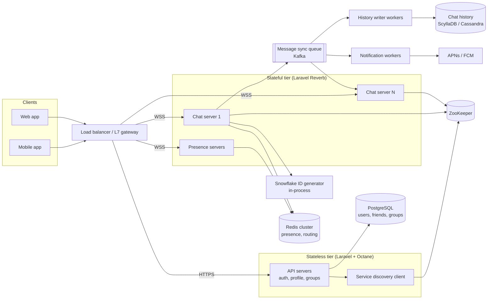
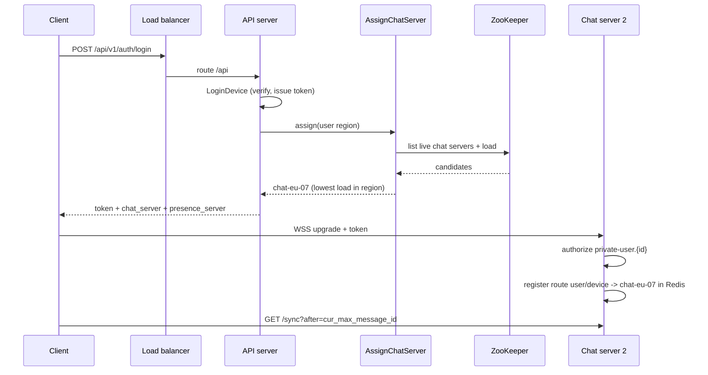
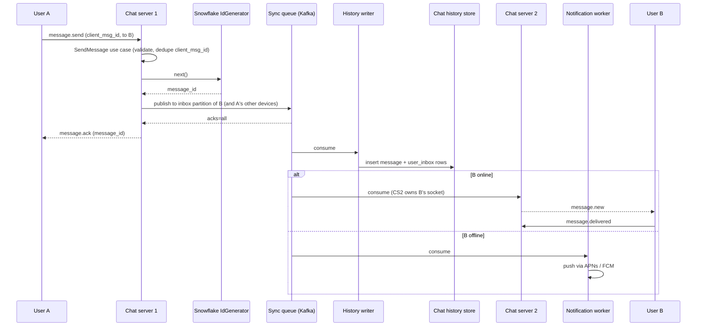
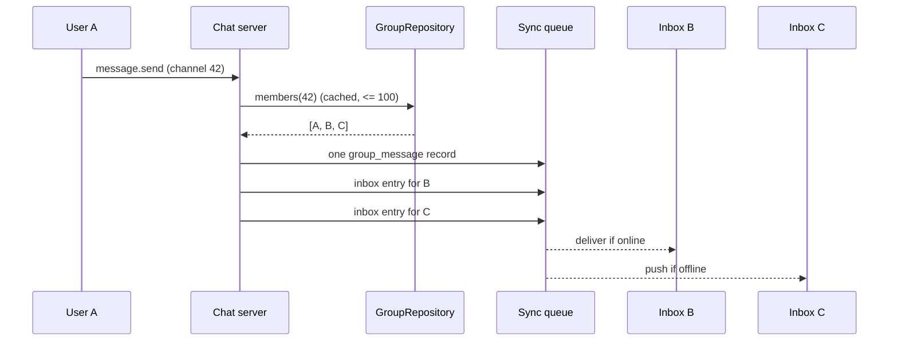
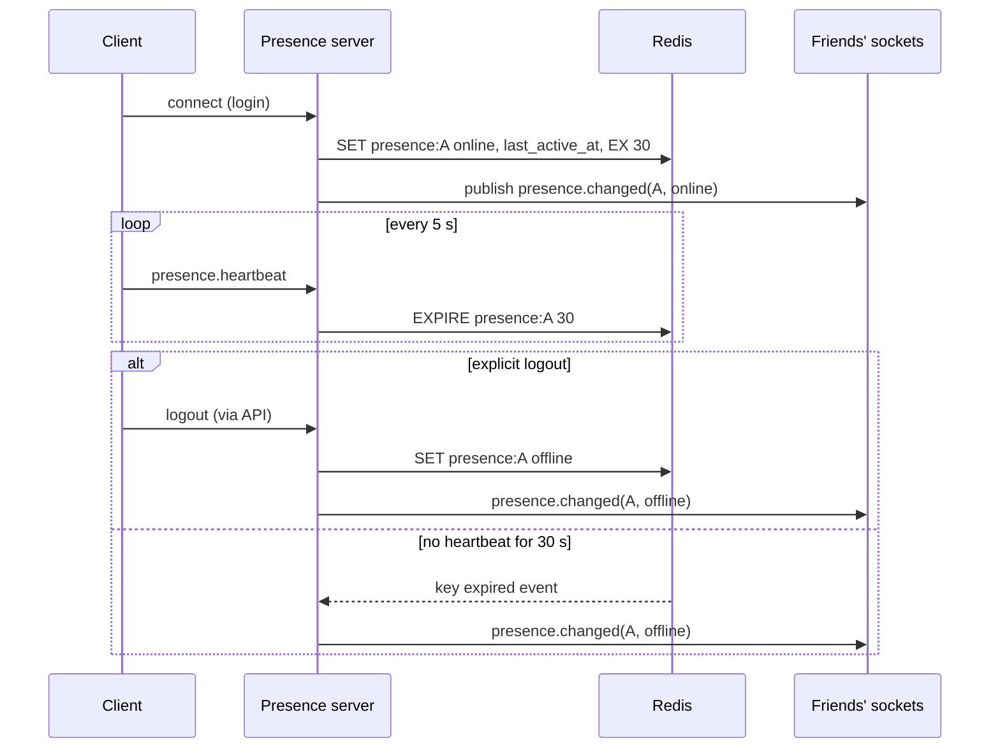

# PDR: Real-Time Chat System (Laravel, Clean Architecture)

Nov 11, 2026 · @Mohamed abughrara

## 1. Document control

| Field | Value |
| --- | --- |
| Title | Preliminary Design Review: Real-Time Chat System |
| Version | 0.1 (draft for review) |
| Author | Mohamed Abughrara |
| Date | 11 Nov 2026 |
| Reviewers | Architecture lead, Backend lead (PHP), SRE lead, Security lead (names to be confirmed) |
| Status | Draft |
| Stack | PHP 8.3, Laravel 11, Clean Architecture |
| Baseline source | [ByteByteGo: Design a Chat System](https://bytebytego.com/courses/system-design-interview/design-a-chat-system) |

Every item not stated in the baseline source is marked **Assumption**.

## 2. Executive summary

We will build a text chat service for 50 million daily users, with 1-on-1 and small group chat (up to 100 members), presence, multi-device sync and push notifications, written in Laravel with Clean Architecture.

The design follows the ByteByteGo reference. Clients hold one WebSocket to a stateful chat server. Stateless Laravel API servers handle sign-up, login, profiles and groups. Messages pass through a sync queue and are stored forever in a wide-column key-value store, while user data lives in a sharded relational database.

The main PHP-specific decision is to run chat and presence servers on **Laravel Reverb** (long-running WebSocket processes), with domain logic kept in framework-free use cases. The main risks for review are Reverb at 1M connections, the PHP driver for the chat-history store, and heartbeat load on presence.

## 3. Goals, non-goals and success metrics

**Goals**

- Real-time 1-on-1 and group text chat on mobile and web
- Same conversation state on every logged-in device
- Chat history kept forever, searchable by message ID range
- Domain logic independent of Laravel, storage and transport (Clean Architecture)

**Non-goals for v1**

- Media and file attachments
- End-to-end encryption
- Groups larger than 100 members, channels or broadcast lists
- Full-text message search

**Success metrics (Assumption: targets to confirm at review)**

| Metric | Target |
| --- | --- |
| 1-on-1 delivery latency, sender to online recipient | p99 under 500 ms in-region |
| Message durability | 0 acknowledged messages lost |
| Chat service availability | 99.95% monthly |
| Presence accuracy | Offline shown within 30 s of last heartbeat |
| Multi-device catch-up after reconnect | p95 under 2 s for up to 500 missed messages |
| Push notification dispatch for offline user | p95 under 5 s |

## 4. Requirements

**Functional**

| ID | Requirement | Source |
| --- | --- | --- |
| FR-01 | Users sign up, log in and manage a profile | Baseline |
| FR-02 | Send and receive 1-on-1 text messages | Baseline |
| FR-03 | Create groups of up to 100 members; send and receive group messages | Baseline |
| FR-04 | Text only, max 100,000 characters per message | Baseline |
| FR-05 | Show online/offline status of friends | Baseline |
| FR-06 | One account active on several devices; all devices stay in sync | Baseline |
| FR-07 | Push notification when the recipient is offline | Baseline |
| FR-08 | Store chat history forever; load history by paging backwards | Baseline |
| FR-09 | Delivery acknowledgement (sent, delivered) per message | Assumption |
| FR-10 | Client-generated idempotency key so retries never duplicate a message | Assumption |

**Non-functional**

| ID | Requirement | Source |
| --- | --- | --- |
| NFR-01 | 50M DAU | Baseline |
| NFR-02 | \~1M concurrent WebSocket connections, scale out horizontally | Baseline |
| NFR-03 | Low latency for 1-on-1 delivery (p99 < 500 ms in-region) | Baseline + Assumption on figure |
| NFR-04 | Read:write ratio \~1:1 | Baseline |
| NFR-05 | No single point of failure in any tier | Baseline |
| NFR-06 | Per-conversation message order is strict and stable | Baseline |
| NFR-07 | At-least-once delivery, exactly-once display (dedupe on client by message ID) | Assumption |
| NFR-08 | TLS on every hop; tokens on every connection | Assumption |
| NFR-09 | Domain and application layers have zero Laravel or vendor imports | Clean Architecture |

## 5. Capacity estimation

The system must absorb about 70K message writes/s and 310K deliveries/s at peak, store about 660 TB of replicated history per year, and hold 1M sockets on roughly 26 WebSocket nodes.

**Inputs.** Baseline: 50M DAU, 1M concurrent connections, \~10 KB memory per connection, 5 s heartbeat. Assumption: 40 messages per user per day, 25% of messages are group messages with an average of 15 members, peak = 3x average, 300 bytes per stored row, \~1 KB per WebSocket frame, 50K connections per Reverb node.

| Quantity | Calculation | Result |
| --- | --- | --- |
| Messages per day | 50M × 40 | 2.0 billion |
| Average write rate | 2.0B ÷ 86,400 s | \~23K msg/s |
| Peak write rate | 23K × 3 | \~70K msg/s |
| Deliveries per day | 1.5B (1-on-1) + 0.5B × 15 (group) | \~9.0 billion |
| Peak delivery rate | 9.0B ÷ 86,400 × 3 | \~312K/s |
| Raw history per day | 2.0B × 300 B | \~600 GB |
| Raw history per year | 600 GB × 365 | \~219 TB |
| Replicated per year (RF = 3) | 219 TB × 3 | \~657 TB (≈330 TB with \~2x compression, Assumption) |
| Connection memory | 1M × 10 KB | \~10 GB |
| WebSocket nodes | 1M ÷ 50K = 20, +25% headroom, N+2 | \~26 nodes (\~40 at a 2M peak) |
| Heartbeat rate | 1M ÷ 5 s | 200K writes/s to presence |
| Peak egress | 312K/s × 1 KB | \~312 MB/s (\~2.5 Gbps) |

Two figures drive the design: heartbeats (200K/s) outnumber message writes, so presence needs its own Redis cluster; and group fan-out multiplies delivery work about 4.5x over writes, which is why the 100-member cap matters.

## 6. System architecture

Clients talk only to our services: stateless Laravel API servers over HTTPS, and stateful Reverb chat and presence servers over WebSocket. All servers share one Clean Architecture codebase deployed as different process types.

### 6.1 Component diagram



### 6.2 Components

| Component | Responsibility | Technology | Type |
| --- | --- | --- | --- |
| Load balancer | TLS termination, path routing (/api vs /ws), sticky WebSocket | NGINX or cloud L7 LB (Assumption) | Stateless |
| API servers | Sign-up, login, profile, friends, groups, history paging | Laravel 11 on Octane (Swoole) | Stateless |
| Service discovery | Pick the best chat server by region and load after login | ZooKeeper (baseline); PHP client via pecl `zookeeper` | Stateless |
| Chat servers | Hold WebSockets, accept `message.send`, assign IDs, publish to queue, deliver to local sockets | Laravel Reverb (Assumption) | Stateful |
| Presence servers | Heartbeats, online/offline, status fan-out | Laravel Reverb + Redis | Stateful |
| Message sync queue | Durable per-recipient inbox stream between chat servers | Kafka, partitioned by recipient ID (Assumption) | Infra |
| History writer workers | Persist messages to the KV store | Laravel queue consumers | Stateless |
| Notification workers | Push to offline users | Laravel Notifications + APNs/FCM | Stateless |
| Chat history store | Messages forever | ScyllaDB/Cassandra (baseline: KV store) | Data |
| Relational DB | Users, profiles, friends, groups, devices | PostgreSQL, replicated + sharded (Assumption on engine) | Data |
| Redis cluster | Presence, user-to-chat-server routing, rate limits | Redis Cluster | Data |

### 6.3 Clean Architecture layering

Dependencies point inward only. The Domain and Application layers are plain PHP; Laravel lives in the outer two rings.

| Layer | Contents | May depend on |
| --- | --- | --- |
| Domain | Entities (`Message`, `Conversation`, `Group`, `User`, `Device`), value objects (`MessageId`, `MessageBody` max 100K chars, `ChannelId`), domain events (`MessageSent`), repository interfaces | Nothing |
| Application | Use cases (`SendMessage`, `SyncDevice`, `FetchHistory`, `CreateGroup`, `RecordHeartbeat`, `AssignChatServer`), input/output DTOs, ports (`IdGenerator`, `MessageQueue`, `PresenceStore`, `PushNotifier`, `ServerRegistry`) | Domain |
| Infrastructure | Eloquent repositories (PostgreSQL), Scylla message repository, Kafka adapter, Redis presence adapter, Snowflake generator, ZooKeeper registry, FCM/APNs notifier | Application, Domain |
| Presentation | HTTP controllers + Form Requests, API Resources, Reverb event listeners (`MessageReceived`), console commands for workers | Application |

Bindings from ports to adapters sit in Laravel service providers, so a store or queue can be swapped without touching use cases.

```text
src/
  Domain/Chat/        Entities, ValueObjects, Events, Repositories (interfaces)
  Domain/Identity/
  Application/Chat/   UseCases, DTOs, Ports
  Application/Presence/
  Infrastructure/Persistence/{Eloquent,Scylla}
  Infrastructure/Messaging/Kafka
  Infrastructure/Presence/Redis
  Infrastructure/Discovery/ZooKeeper
  Infrastructure/Push/{Fcm,Apns}
app/
  Http/Controllers, Http/Requests, Http/Resources
  Realtime/Listeners   (Reverb MessageReceived -> use case)
  Providers/           (port -> adapter bindings)
```

## 7. API design

REST covers account, group and history operations; WebSocket covers everything real-time. All endpoints are versioned under `/api/v1` and authenticated with Laravel Sanctum bearer tokens (Assumption).

### 7.1 REST endpoints (API servers)

| Method | Path | Purpose | Use case |
| --- | --- | --- | --- |
| POST | /api/v1/auth/register | Create account | `RegisterUser` |
| POST | /api/v1/auth/login | Log in a device, return token + assigned chat server | `LoginDevice`, `AssignChatServer` |
| POST | /api/v1/auth/logout | Revoke device token, mark offline | `LogoutDevice` |
| GET / PATCH | /api/v1/me | Read or update profile | `GetProfile`, `UpdateProfile` |
| GET | /api/v1/friends | Friend list with last known presence | `ListFriends` |
| POST | /api/v1/groups | Create group (max 100 members) | `CreateGroup` |
| POST / DELETE | /api/v1/groups/{id}/members | Add or remove members | `ChangeGroupMembers` |
| GET | /api/v1/conversations/{id}/messages?before={message\_id}&limit=50 | Page history backwards | `FetchHistory` |
| GET | /api/v1/sync?after={cur\_max\_message\_id} | Catch up a device after reconnect | `SyncDevice` |
| POST | /api/v1/devices/push-token | Register APNs/FCM token | `RegisterPushToken` |

Login response:

```json
{
  "token": "1|q8Zk...",
  "user_id": 81234567,
  "device_id": "d-7f3a",
  "chat_server": { "host": "chat-eu-07.example.com", "port": 443 },
  "presence_server": { "host": "presence-eu-02.example.com", "port": 443 }
}
```

### 7.2 WebSocket events (chat and presence servers)

Reverb speaks the Pusher protocol, so app events travel as client events on the user's private channel `private-user.{user_id}`.

| Direction | Event | Payload (main fields) |
| --- | --- | --- |
| Client → server | `message.send` | `client_msg_id`, `conversation_id` or `to_user_id`, `content` |
| Server → client | `message.ack` | `client_msg_id`, `message_id`, `created_at` |
| Server → client | `message.new` | `message_id`, `conversation_id`, `from`, `content`, `created_at` |
| Client → server | `message.delivered` | `message_id` |
| Client → server | `presence.heartbeat` | `device_id` (every 5 s) |
| Server → client | `presence.changed` | `user_id`, `status`, `last_active_at` |
| Server → client | `error` | `code`, `client_msg_id`, `retryable` |

Send and acknowledgement:

```json
{ "event": "client-message.send",
  "channel": "private-user.81234567",
  "data": { "client_msg_id": "c-01J9X...", "to_user_id": 92345678,
            "content": "Hi, are we still on for 3pm?" } }

{ "event": "message.ack",
  "channel": "private-user.81234567",
  "data": { "client_msg_id": "c-01J9X...", "message_id": "7262035819283456001",
            "created_at": "2026-11-11T10:15:02.114Z" } }
```

Message IDs are 64-bit integers, so they are sent to JavaScript clients as strings to avoid precision loss (Assumption).

## 8. Data model and storage design

User, friend and group data goes to PostgreSQL; messages and per-user inboxes go to ScyllaDB/Cassandra, partitioned so every hot query reads one partition.

### 8.1 Chat history (KV / wide-column store)

Baseline tables, with partition keys adapted for a wide-column store:

```sql
-- 1-on-1 messages (baseline columns; partitioned by conversation - Assumption)
CREATE TABLE message (
  conversation_id bigint,   -- derived from the sorted user pair
  message_id      bigint,   -- Snowflake, defines order
  message_from    bigint,
  message_to      bigint,
  content         text,     -- max 100,000 chars (validated in MessageBody)
  created_at      timestamp,
  PRIMARY KEY ((conversation_id), message_id)
) WITH CLUSTERING ORDER BY (message_id DESC);

-- Group messages (baseline)
CREATE TABLE group_message (
  channel_id  bigint,
  message_id  bigint,
  user_id     bigint,
  content     text,
  created_at  timestamp,
  PRIMARY KEY ((channel_id), message_id)
) WITH CLUSTERING ORDER BY (message_id DESC);

-- Per-user inbox for multi-device sync (Assumption)
CREATE TABLE user_inbox (
  user_id          bigint,
  bucket           int,      -- month bucket to cap partition size
  message_id       bigint,
  conversation_id  bigint,
  is_group         boolean,
  PRIMARY KEY ((user_id, bucket), message_id)
);
```

**Why `created_at` cannot define order.** Two messages can be created in the same millisecond, and clocks on different chat servers drift, so timestamps can tie or run backwards. `message_id` is unique and strictly increasing per generator, so it gives one stable order. `created_at` is kept only for display.

### 8.2 Relational store (PostgreSQL)

| Table | Key columns | Notes |
| --- | --- | --- |
| users | id, phone/email, display\_name, created\_at | Sharded by `id` |
| devices | id, user\_id, platform, push\_token, last\_seen\_at | One row per logged-in device |
| friendships | user\_id, friend\_id, created\_at | Stored both directions |
| groups | id, name, owner\_id, member\_count | `member_count <= 100` check |
| group\_members | group\_id, user\_id, role, joined\_at | Sharded by `group_id` |
| conversations | id, user\_low, user\_high | Maps a user pair to `conversation_id` |

### 8.3 Partitioning, replication, retention

| Store | Partitioning | Replication | Retention |
| --- | --- | --- | --- |
| ScyllaDB/Cassandra | By conversation, channel, or (user, month) | RF 3 per region, `LOCAL_QUORUM` reads and writes | Forever (baseline); TWCS compaction (Assumption) |
| PostgreSQL | Application-level shards by user or group ID (Assumption: 16 to start) | 1 primary + 2 replicas per shard | Forever; soft delete for accounts |
| Kafka | Topic partitioned by recipient user ID | RF 3, `acks=all` | 7 days (Assumption) |
| Redis | Hash slots (Redis Cluster) | 1 replica per primary | Presence TTL 30 s; routing TTL tied to connection |

In the code, these are hidden behind `MessageRepository`, `InboxRepository` and `GroupRepository` interfaces in the Domain layer.

## 9. Detailed flows

Each flow maps to one Application use case; the diagrams name the use case where it runs.

### 9.1 Login, service discovery, WebSocket connect



### 9.2 1-on-1 message send



The sender gets `message.ack` once Kafka confirms the write, which makes the message durable before it is in the KV store (Assumption). Chat servers consume only the partitions for users connected to them, found through the Redis routing table.

### 9.3 Multi-device sync

```mermaid
sequenceDiagram
  participant P as Phone
  participant L as Laptop
  participant CS as Chat server
  participant KV as user_inbox
  Note over P,L: each device keeps its own cur_max_message_id
  P->>CS: reconnect, sync after=1000
  CS->>KV: SELECT where user_id=A and message_id > 1000
  KV-->>CS: messages 1001..1042
  CS-->>P: batch; phone sets cur_max=1042
  L->>CS: reconnect, sync after=980
  CS->>KV: SELECT where user_id=A and message_id > 980
  KV-->>CS: messages 981..1042
  CS-->>L: batch; laptop sets cur_max=1042
```

Each device syncs on its own session, so one slow device never blocks another. Messages a user sends from one device are also written to their own inbox, so the other devices see them.

### 9.4 Small group fan-out



The message body is stored once in `group_message`; only small inbox pointers are copied per member. This keeps a 100-member group to 100 cheap writes.

### 9.5 Presence



Status changes fan out through one pub/sub channel per friend pair (baseline). For groups, members fetch presence on demand when they open the group, instead of receiving every change.

## 10. Key design decisions and trade-offs

Eight decisions need sign-off; D-01 to D-06 come from the baseline, D-07 and D-08 are specific to Laravel.

| ID | Decision | Options considered | Pros | Cons | Choice and rationale |
| --- | --- | --- | --- | --- | --- |
| D-01 | Real-time protocol | Polling | Simple, works over plain HTTP | Most requests return nothing; wastes server and battery | Rejected |
|  |  | Long polling | Fewer empty responses | Sender and receiver may hit different servers; hard to detect disconnects; inefficient for quiet users | Rejected |
|  |  | **WebSocket** | Bidirectional, persistent, low latency; ports 80/443 pass firewalls | Stateful servers; connection management is harder | **Chosen** for send and receive |
| D-02 | Service split | All stateless / all stateful / **split** | Split scales each tier on its own metric | Two deployment types | **Split**: only chat and presence are stateful |
| D-03 | Chat history store | Relational DB | Familiar, strong queries | Large indexes make long-tail random access slow; hard to scale writes | Rejected |
|  |  | **Wide-column KV (ScyllaDB/Cassandra)** | Linear horizontal scaling, low latency, proven (Discord uses Cassandra, Messenger uses HBase) | Query-first modelling; weaker PHP driver ecosystem | **Chosen** |
| D-04 | Message ID | DB auto-increment | Simple | KV stores lack it; single writer hotspot | Rejected |
|  |  | Per-channel local sequence | Simple ordering per conversation | Needs a strongly consistent counter per channel; no global order for `user_inbox` sync | Rejected (Assumption: reconsider if Snowflake clock issues appear) |
|  |  | **64-bit Snowflake, in-process** | Unique, time-sortable, no network hop; global order supports per-user sync | Needs unique worker IDs and clock-skew handling | **Chosen**; worker IDs leased from ZooKeeper |
| D-05 | Group fan-out | **Copy to each member's inbox** | Each client reads only its own inbox; simple sync | Writes grow with group size | **Chosen** for groups up to 100 (WeChat uses a similar model with a 500 cap) |
|  |  | Read from shared channel log | One write per message | Each client must poll many channels | Kept for future large groups |
| D-06 | Presence detection | Mark offline on disconnect | Immediate | Flickers on short network drops | Rejected |
|  |  | **Heartbeat, 5 s interval, 30 s timeout** | Stable status; tolerates brief drops | Up to 30 s stale; 200K writes/s | **Chosen**, with pub/sub per friend pair and on-demand fetch for groups |
| D-07 | PHP WebSocket runtime | **Laravel Reverb** | First-party, Pusher protocol, works with Laravel Echo clients, horizontal scaling via Redis | Unproven at 1M sockets for us; Redis scaling broadcasts to every node | **Chosen for v1** (Assumption), gated by a load-test spike |
|  |  | Swoole/OpenSwoole (e.g. Hyperf) | Very high connection density | Second framework; custom protocol | Fallback if the spike fails |
|  |  | Node.js or Go gateway | Mature at scale | Breaks the single-codebase goal | Rejected for v1 |
| D-08 | Where business logic lives | Inside controllers and Reverb listeners | Fast to write | Untestable without the framework; locks us to Reverb | Rejected |
|  |  | **Clean Architecture use cases** | Same `SendMessage` runs from WebSocket, HTTP or tests; adapters swappable | More files and mapping code | **Chosen** |

## 11. Scalability and availability

Every tier scales horizontally and survives the loss of one node or one availability zone without losing acknowledged messages.

| Area | Design |
| --- | --- |
| Load balancing | L7 balancer routes `/api` round-robin to Octane workers; `/ws` connects to the host named by service discovery. Spread across 3 availability zones (Assumption). |
| Chat server failover | Each Reverb node holds an ephemeral ZooKeeper node. When a node dies, its znode disappears, discovery stops assigning it, and clients reconnect with exponential backoff and jitter (1 s to 30 s, Assumption) to a new server. |
| Reconnect and catch-up | On reconnect a device calls `sync?after=cur_max_message_id`, so nothing sent during the outage is lost. Redis routing entries for the dead node expire by TTL. |
| Message retry and queueing | Client retries `message.send` with the same `client_msg_id` until it gets `message.ack`. `SendMessage` dedupes on `client_msg_id` (Redis SETNX, 24 h). Kafka `acks=all` keeps messages if consumers are down; consumers commit offsets only after the write succeeds. |
| Poison messages | After 5 failed attempts a record moves to a dead-letter topic and raises an alert (Assumption). |
| Graceful deploys | Reverb nodes drain: stop accepting new sockets, send a `reconnect` hint, close over 5 minutes, so 26 nodes never reconnect at once. |
| Stateless scaling | Octane API servers and queue workers autoscale on CPU and queue lag. |
| Data tier | ScyllaDB adds nodes online; PostgreSQL adds shards through a user-to-shard map; Redis Cluster reshards hash slots. |
| Multi-region | v1 is single-region active, with backups replicated to a second region (Assumption). Multi-region active-active is future work. |

## 12. Security and privacy

v1 encrypts all traffic in transit and data at rest, but not end to end; E2EE is deferred.

| Area | Control |
| --- | --- |
| Authentication | Sanctum token per device, issued at login, revoked at logout or device removal (Assumption on Sanctum) |
| WebSocket authorization | Reverb private channels: `private-user.{id}` authorized only for that user; group sends checked against `group_members` in `SendMessage` |
| Transport | TLS 1.2+ on client links (HTTPS, WSS); mTLS or private network between services (Assumption) |
| At rest | Disk encryption on ScyllaDB, PostgreSQL, Redis and Kafka volumes; secrets in a vault, never in `.env` on servers |
| Rate limiting | Per user and per IP: e.g. 20 messages/s burst, 5 group creations/hour, login attempts with lockout (Assumption on figures) |
| Input validation | `MessageBody` value object rejects over 100,000 characters and invalid UTF-8; output escaped on web clients |
| Abuse prevention | Block and report endpoints; spam scoring as a queue consumer; temporary send bans |
| Privacy | Data export and account deletion flows; logs never contain message content; PII access audited |
| Future: E2EE | Signal-protocol style key exchange; server then stores ciphertext only, which limits server-side features |

## 13. Monitoring, observability and SLOs

We track one end-to-end SLI per user promise, plus the tier metrics that explain it.

**SLOs (Assumption: to confirm at review)**

| SLI | SLO | Measured as |
| --- | --- | --- |
| Send success | 99.95% of `message.send` get `message.ack` within 2 s | Chat server counter |
| Delivery latency (online) | p99 < 500 ms ack-to-`message.new` | Trace span sender to recipient socket |
| Durability | 0 acknowledged messages missing from history | Daily reconciliation job, Kafka vs KV |
| WebSocket availability | 99.95% successful connects | LB + Reverb metrics |
| Presence freshness | 99% of offline transitions within 35 s | Presence server timer |
| Push dispatch | p95 < 5 s | Notification worker |

**Telemetry**

- Metrics (Prometheus + Grafana, Assumption): open sockets per Reverb node, connects/disconnects per second, Kafka consumer lag per group, KV p99 read/write latency, Redis ops/s and memory, Octane worker saturation, PHP memory per long-running process
- Tracing (OpenTelemetry): one trace ID from `message.send` through Kafka to delivery; propagated in Kafka headers
- Logs: structured JSON with `user_id`, `device_id`, `message_id`, never message content
- Laravel tooling: Pulse for app-level health, Horizon for queue workers
- Alerts: consumer lag > 10 s, reconnect storm (>5% of sockets in 1 min), Reverb node memory > 80%, dead-letter topic non-empty

## 14. Risks, open questions and mitigations

The biggest risk is the PHP real-time runtime; a load-test spike before build start retires most of it.

| ID | Risk | Likelihood | Impact | Mitigation |
| --- | --- | --- | --- | --- |
| R-01 | Reverb cannot hold 50K sockets per node, or its Redis scaling (every node receives every broadcast) does not scale to 26+ nodes | Medium | High | 2-week spike at 1M simulated sockets; fallback to Swoole/Hyperf gateway behind the same use cases (D-07) |
| R-02 | Inbound client events through Reverb `MessageReceived` listeners add latency or block the event loop | Medium | High | Keep listeners non-blocking; hand work to Kafka quickly; measure in spike |
| R-03 | PHP driver for ScyllaDB/Cassandra is community-maintained (the DataStax PHP driver is no longer maintained) | High | Medium | Isolate behind `MessageRepository`; evaluate the ScyllaDB PHP driver fork; fallback to DynamoDB via the AWS SDK for PHP |
| R-04 | Memory leaks in long-running PHP processes (Octane, Reverb, workers) | Medium | Medium | Max-request recycling for Octane, memory alerts, scheduled rolling restarts |
| R-05 | Redis key-expiry events are not guaranteed to fire on time, so offline may show late | Medium | Low | Presence server also sweeps expired keys every 5 s; clients treat `last_active_at` > 30 s as offline |
| R-06 | Reconnect storm after a node or zone failure | Medium | High | Jittered backoff, connection rate limit per node, graceful drain on deploy |
| R-07 | Snowflake clock skew produces out-of-order IDs | Low | Medium | NTP monitoring; generator refuses to issue IDs if the clock moves backwards |
| R-08 | Hot partitions for very active 1-on-1 or group conversations | Low | Medium | Month buckets in keys; monitor partition size |

**Open questions**

- [ ] Actual message volume per user and average size, to replace the capacity assumptions
- [ ] Cloud provider and managed options (managed Kafka, managed Cassandra, or self-hosted)
- [ ] ZooKeeper vs Consul or the provider's native discovery
- [ ] Is single-region acceptable for v1 launch markets?
- [ ] Delivery receipts: "delivered" only, or also "read"?
- [ ] Data residency or legal retention rules for stored-forever history

## 15. Future work

| Item | Approach | Impact on v1 design |
| --- | --- | --- |
| Media files | Upload to object storage via pre-signed URLs; compress server-side; generate thumbnails in queue workers; message holds a media reference | New `Attachment` entity and `MediaStorage` port; no change to message flow |
| End-to-end encryption | Signal-style double ratchet; per-device keys; server stores ciphertext | `content` becomes opaque bytes; server-side validation and abuse scanning shrink |
| Client-side caching | Local DB on device (SQLite/IndexedDB) keyed by `message_id`; sync from `cur_max_message_id` | Already supported by the sync API |
| Faster loading | Geo-distributed edge caches for user, channel and group data (like Slack's Flannel) | New read-through cache adapter behind existing repositories |
| Large groups and channels | Switch from inbox copy to a shared channel log read by members; presence on demand only | D-05 alternative becomes active above a size threshold |
| Error handling | Richer client error codes, server-side retry policies per adapter, chaos testing of failover | Builds on section 11 |
| Multi-region active-active | Region-local chat servers, cross-region Kafka replication, conflict-free ID ranges per region | Snowflake datacenter bits already reserve room |

## 16. Review checklist

Reviewers tick each item to sign off.

- [ ] Requirements FR-01 to FR-10 and NFR-01 to NFR-09 are complete and agreed
- [ ] Capacity assumptions (40 msgs/user/day, 300 B rows, 50K sockets/node) accepted or replaced with data
- [ ] WebSocket for send and receive (D-01) approved
- [ ] ScyllaDB/Cassandra for history (D-03) approved, with a decision on the PHP driver risk (R-03)
- [ ] Snowflake IDs with ZooKeeper-leased worker IDs (D-04) approved
- [ ] Inbox-copy fan-out with a 100-member cap (D-05) approved
- [ ] Heartbeat presence, 5 s / 30 s (D-06) approved
- [ ] Laravel Reverb for v1 approved, conditional on the load-test spike (D-07, R-01)
- [ ] Clean Architecture layer rules (D-08, NFR-09) accepted and enforced in CI (e.g. Deptrac)
- [ ] Failover, reconnect and retry design (section 11) accepted
- [ ] Security controls (section 12) accepted by Security
- [ ] SLOs and alerts (section 13) accepted by SRE
- [ ] Owners and dates assigned for every open question (section 14)

## 17. Summary for the review meeting

We ask reviewers to approve the architecture below, with Reverb approved on condition that the load-test spike passes.

**Decisions to approve**

| ID | Decision |
| --- | --- |
| D-01 | WebSocket for both send and receive |
| D-02 | Stateless API tier (Laravel Octane) + stateful chat and presence tier |
| D-03 | ScyllaDB/Cassandra for chat history, PostgreSQL for users and groups |
| D-04 | 64-bit Snowflake message IDs, generated in-process |
| D-05 | Per-member inbox fan-out, groups capped at 100 |
| D-06 | Heartbeat presence: 5 s interval, 30 s timeout, friend-pair pub/sub |
| D-07 | Laravel Reverb as the WebSocket runtime for v1 (conditional) |
| D-08 | Clean Architecture: framework-free Domain and Application layers |

**Key numbers:** 2B messages/day, \~70K writes/s and \~312K deliveries/s at peak, \~657 TB/year replicated history, 1M sockets on \~26 nodes, 200K heartbeats/s.

**Top risks:** Reverb at scale (R-01), Cassandra PHP driver (R-03), reconnect storms (R-06).

**Open items needing owners**

- [ ] Run the Reverb 1M-socket load-test spike (2 weeks)
- [ ] Choose the history store driver or the DynamoDB fallback
- [ ] Replace capacity assumptions with real usage data
- [ ] Confirm cloud provider, managed services and discovery tool
- [ ] Confirm single-region v1 and data-residency rules
- [ ] Decide on read receipts
